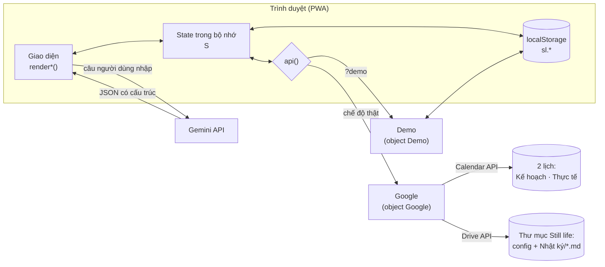
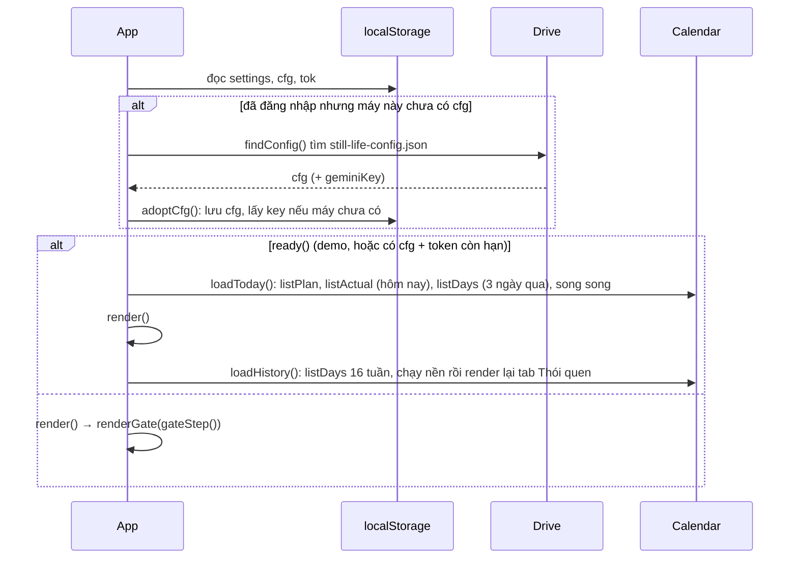
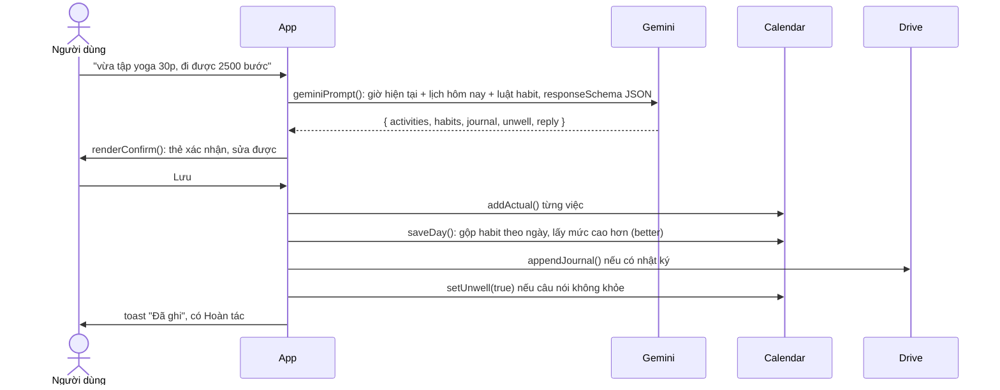

# Still life · Tài liệu kỹ thuật

Dữ liệu đi như thế nào, nằm ở đâu, và code nào đụng tới nó.
Đọc cùng [SPEC.md](SPEC.md) (app làm gì) và [CHANGELOG.md](CHANGELOG.md) (vì sao đổi).

## 1. Bức tranh chung



- **Không có backend.** Trình duyệt gọi thẳng Google Calendar, Google Drive và Gemini bằng token của người dùng.
  Mọi dữ liệu nằm trong Google của người dùng; app không giữ bản sao nào trên server.
- **Một file logic:** `app.js` (script thường, không module, không build). `index.html` là khung, `styles.css` là giao diện.
- **Hai nguồn dữ liệu cùng giao diện:** `Google` (thật) và `Demo` (dữ liệu mẫu trong localStorage).
  Mọi chỗ đọc ghi đều đi qua `api()`, nên phần còn lại của app không cần biết đang ở chế độ nào.

```js
const api = () => (S.settings.demo ? Demo : Google);
```

## 2. Dữ liệu nằm ở đâu

### 2.1 Google Calendar · lịch "Still life · Kế hoạch"
| Loại sự kiện | Cách nhận ra | Tạo bởi |
|---|---|---|
| Khối tuần mẫu | sự kiện **lặp** (`RRULE:FREQ=WEEKLY;BYDAY=…[;UNTIL=…]`), `private.sl=plan`, `private.key=<key TEMPLATE>` (khối thêm ở trang Tuần mẫu: key rỗng), `private.rem` | `Google.setup()` lúc dựng lần đầu, từ `TEMPLATE` qua `planBody()`; sau đó trang Tuần mẫu (`createSeries` / `updateSeries` / `endSeries`) |
| Khối thêm trong app | sự kiện **đơn**, `private.sl=plan`, `private.added=1`, `private.cat` | `Google.addPlan()` |
| Khối đã sửa cho hôm nay | là **1 lần lặp** của khối tuần mẫu bị ghi đè (Calendar tự tách ra exception) | `Google.updatePlan()` |
| Khối đang tắt (unwell) | tên bắt đầu bằng `💤 `, không có nhắc | `Google.mutePlan(items, true)` |

App luôn đọc với `singleEvents=true`, nên mỗi lần lặp có `id` riêng. PATCH vào `id` đó chỉ đổi đúng ngày đó,
các ngày khác của chuỗi lặp giữ nguyên. Đây là lý do "sửa kế hoạch" trong app chỉ có tác dụng cho hôm nay.

`evToItem(ev, "plan")` chuyển sự kiện thành object dùng trong app:
```js
{ id, kind: "plan", key, title /* đã bỏ 💤 */, start: Date, end: Date,
  cat, habit, ess /* thiết yếu, giữ trong unwell */, muted /* có 💤 */, added /* thêm trong app */ }
```
`cat`, `habit`, `ess`, `rem` lấy từ `extendedProperties.private`; **thiếu hẳn** thì tra theo `key` trong `TPL` (bản đồ của `TEMPLATE`).
Có ghi (kể cả rỗng, vd `habit=""`, `ess="0"`) thì giá trị trong sự kiện thắng, để bỏ gắn thói quen / bỏ giữ rest day ở trang Tuần mẫu có tác dụng.
`rem` = phút nhắc trước, nối bằng dấu phẩy (`"30,0"`, `""` = không nhắc); sự kiện cũ chưa có thì lấy `TPL[key].rem` hoặc `[0]`.

**Tuần mẫu** đọc sự kiện gốc của chuỗi (`singleEvents=false`) qua `evToSeries(ev)`:
```js
{ id, key, title, cat, days: [0..6], s: "HH:MM", e: "HH:MM", habit, ess, rem, from: "YYYY-MM-DD" /* lần lặp đầu */, until /* lần lặp cuối hoặc null */, recurrence }
```
Chỉ nhận `FREQ=WEEKLY` / `DAILY`, không `COUNT`, không `INTERVAL` khác 1 (chuỗi lạ tạo trong Google Calendar bị bỏ qua, không sửa được trong app).
`listSeries()` chỉ trả chuỗi còn chạy từ ngày mai (`until` trống hoặc ≥ mai). `UNTIL` ghi theo UTC của 23:59:59 giờ máy (`untilUTC`).

### 2.2 Google Calendar · lịch "Still life · Thực tế"
| Loại | Cách nhận ra | Nội dung |
|---|---|---|
| Việc đã làm | `private.sl=act` | `summary`, giờ, `colorId` theo nhóm, `private.cat`, `private.plan` (id khối kế hoạch nếu bấm "Đã làm"), `private.habit`, `private.hprev` (mức thói quen trước khi bấm Đã làm: `none`/`min`/`full`/`skip`; rỗng nếu không đụng thói quen) |
| Bản ghi ngày | `private.sl=day`, sự kiện **cả ngày** "Thói quen · d/m" | trạng thái habit, unwell, khối bỏ qua, khối đã tắt |

Bản ghi ngày được lưu dạng chuỗi trong `extendedProperties.private` (Calendar chỉ cho chuỗi), qua `recToProps()` / `recFromEv()`:
```js
{ id, date: "YYYY-MM-DD",
  h: { eat: "full" | "min" | "skip", ... },   // trạng thái từng habit
  v: { walk: 2400 },                          // giá trị đo được (số bước…)
  unwell: bool, reason: string /* ≤500 ký tự */,
  skip:  [planId, ...],   // khối kế hoạch đã bấm "Bỏ qua"
  muted: [planId, ...] }  // khối bị tắt khi bật unwell, để bật lại đúng những khối đó
```

### 2.3 Google Drive · thư mục "Still life"
| File | Nội dung |
|---|---|
| `still-life-config.json` | `{ planCal, actualCal, folderId, journalFolderId, start, v, geminiKey, habits }`. `start` là ngày bắt đầu theo dõi, các ô trước ngày này hiện "none". `habits` là danh sách thói quen (mục 3.8). Dựng lịch mới ghi `habits: []`. Không có trường này là cấu hình cũ: dùng `SAMPLE_HABITS` rồi ghi lên Drive một lần |
| `Nhật ký/YYYY-MM-DD.md` | Markdown: `# Nhật ký · …` rồi các mục `## Vui vì`, `## Biết ơn`, `## Mai muốn`, `## Ghi thêm`. Ghi bằng `journalMd()`, đọc bằng `parseJournal()` |

Scope OAuth chỉ có `calendar.app.created` và `drive.file`: app chỉ thấy lịch và file do chính nó tạo, không đọc được lịch hay file khác của người dùng.

### 2.4 localStorage (khoá `sl.*`, chỉ trên máy này)
| Khoá | Nội dung |
|---|---|
| `sl.settings` | `{ clientId, geminiKey, model, demo }` |
| `sl.cfg` | bản sao `still-life-config.json` + `configFileId`, để mở app không phải hỏi Drive |
| `sl.tok` | `{ t: access_token, exp }`; hết hạn trước 60 giây để không gọi Google bằng token sắp chết |
| `sl.habView` | đang xem Thói quen theo `week` hay `month` |
| `sl.habits` · `sl.demoHabits` | danh sách thói quen của chế độ thật / demo (bản trong máy, hiện ngay khi mở app) |
| `sl.demo` | toàn bộ dữ liệu chế độ demo: `days`, `actual`, `journal`, `muted`, `planEdit` (sửa khối mẫu theo id lần lặp), `planExtra` (khối thêm) |

### 2.5 State trong bộ nhớ (`S`)
```js
S = {
  settings, cfg, tok,                 // nạp từ localStorage
  view: "today" | "habits" | "journal",
  today: { plan: [...], actual: [...], rec },   // dữ liệu của hôm nay, nguồn cho tab Hôm nay
  days: { "YYYY-MM-DD": rec },        // bản ghi ngày đã tải (16 tuần gần nhất + tải thêm khi lùi)
  pending,                            // kết quả Gemini đang chờ xác nhận
  habView, habWeek, calMonth,         // đang xem tuần/tháng nào ở tab Thói quen
  habManage, habEdit, habLooked,      // đang ở trang Quản lý thói quen · id đang sửa · đã đọc danh sách từ Drive trong phiên này
  editPlan, editAct, dayDate,         // id đang mở trong sheet sửa
  tplOpen, tplDay, tplList, tplEdit, tplErr,   // trang Tuần mẫu: đang mở · thứ đang xem · các chuỗi (null = đang tải) · id đang sửa · tải lỗi
  jfiles, jprev, jopen,               // nhật ký: danh sách file {id,date,mod}, câu đầu mỗi trang, trang đang mở trong sheet
  jdirty,                             // đang gõ dở trong form (quay lại tab không vẽ lại để khỏi mất chữ)
}
```
Quy tắc: **ghi vào Google/Demo trước, thành công rồi mới cập nhật `S`, sau đó render lại.** Lỗi thì `S` giữ nguyên.

## 3. Các luồng chính

### 3.1 Mở app

`refresh()` chạy lại mỗi khi tab được mở lại (`visibilitychange`). Tab Hôm nay tự render lại mỗi phút để cập nhật "Bây giờ".

### 3.2 Cổng vào (`gateStep` / `renderGate`)
`gateStep()` trả bước đang chờ, `null` = vào app. Thứ tự kiểm tra:
`demo` → null · `!signedIn()` → `"login"` · không key và không `settings.keyLater` → `"key"` · không `S.cfg` → `"cal"`.
`render()` gọi `gateStep()` trước tiên: có bước thì `renderGate(step)` vẽ vào `#gate` và thêm class `is-gated` cho `body`
(CSS ẩn `.top`, `main`, `.tabs`, `.fab`, dock). `refresh()` không tải dữ liệu khi cổng đang che.
1. `gateLogin()`: `signIn(!S.cfg)` (lần đầu xin quyền, lần sau chỉ chọn tài khoản). Token sống ~1 tiếng, không refresh token.
   Chưa có `cfg` thì `findConfig()` ngay; thấy thì `adoptCfg()` (lấy luôn key nếu có trên Drive).
2. `gateKey()`: `testKey()` (liệt kê model bằng key) thành công mới lưu key + model, `syncKey()`. "Để sau" đặt `settings.keyLater = true`.
3. `gateSetup()`: `Google.setup()` tạo thư mục, 2 lịch, các khối `TEMPLATE`, ghi file cấu hình (kèm key nếu có); tiến độ ghi vào `#gStep`.
   "Xem lịch mẫu" bật `settings.demo`.
Lỗi ở mỗi bước: trả nút về như cũ (`busy()` → hàm restore) và ghi vào `#gateErr`, không đổi bước.
Mỗi phút, nếu token vừa hết và không có sheet nào mở, `render()` để hiện bước 1.

### 3.3 Nhập câu → Gemini → lưu

- Gemini: thử model đang chọn, rồi lần lượt các model dự phòng nếu gặp 429, 5xx, 404 (`geminiJSON(prompt, schema, temperature)`, dùng chung;
  `callGemini(text)` là lời gọi cho câu kể hằng ngày).
  Thiếu key, key sai (401, 403, thông báo có "API key") → lỗi có `needKey`, toast hiện nút "Mở Cài đặt".
- Sheet xác nhận: mỗi thẻ việc có ô ngày sửa được (`dateField`, giá trị qua `validDay`: không rỗng, không tương lai),
  tô màu khi khác hôm nay; chip thói quen có `date` khác hôm nay hiện nhãn ngắn (`dayShort`: "Hôm qua" hoặc "T6 13/11/2026"). Không còn gì để ghi (`pendingEmpty`)
  thì khoá Lưu, trừ chế độ "Làm việc khác". Bỏ hết dòng thì ẩn lời đáp cũ. Giờ ngược có cảnh báo (`timeWarn`), khi lưu thành 15 phút.
- "Tự thêm" (`#btnManual` → `openManual()`): không gọi Gemini, `manualPending(text)` dựng sẵn một `pending` có 1 việc
  (`manual: true`) rồi đi chung `renderConfirm` → `savePending`, nên ngày, cảnh báo giờ, hoàn tác, "Làm việc khác" đều như luồng AI.
  Tên trống khi lưu thì lấy tên nhóm. Nút "+ Thêm việc" (`#cAddAct`): `syncPending()` rồi đẩy `nextActivity(thẻ cuối)` và dựng lại sheet.
- Chế độ demo không có key thì dùng `demoParse()` (bắt từ khoá đơn giản) để vẫn thử được luồng.
- Hoàn tác: xoá các việc vừa tạo, trả bản ghi ngày về bản chụp trước khi lưu (`restoreRec`), trả lại nhật ký cũ.

### 3.4 Habit
- Ghi: `setHabit(date, id, level)` → đọc bản ghi ngày hiện có, đổi `h[id]`, `saveRec()` → `api().saveDay()` (tạo mới hoặc PUT đè).
  Chip Hôm nay và sheet một ngày gọi qua `queueHabit()`: các lần ghi chạy lần lượt trên một hàng đợi (`habQ`), lần sau đọc bản đã lưu (đã có `id`),
  nên bấm nhanh không tạo hai sự kiện cho một ngày và lần bấm cuối thắng. Sheet một ngày đổi `aria-pressed` ngay, đánh dấu dòng `aria-busy`
  + icon `ph-circle-notch spin` (đếm `data-saving` cho nhiều lần bấm), lưu xong trả icon; lỗi thì vẽ lại sheet theo dữ liệu thật.
- Trạng thái một ô: `cellStatus(hb, d)` trả `full | min | rest | miss | pending | off | none | future`.
  Thứ tự kiểm: tương lai → đã ghi → trước ngày bắt đầu → không có lịch → unwell → Gym theo tuần → hôm nay → bỏ.
- `weekCount()` đếm theo tuần (unwell không tính vào mẫu số). Gym tính theo số buổi/tuần (1 là đạt, 2 là đủ). Cờ `star` (đủ cả tuần) vẫn tính nhưng bảng Tuần không còn hiện ★, chỉ hiện "đã/tổng".
- `streak()`: đi lùi từ hôm nay; `pending`, `rest`, `off` bỏ qua không làm gãy chuỗi; Gym đếm theo tuần.

### 3.8 Danh sách thói quen
- Biến toàn cục: `ALLH` (mọi thói quen, kể cả `off`, theo thứ tự người dùng) · `HABITS` (đang theo dõi, xếp theo thứ tự nhóm trong `CATS`,
  trong nhóm giữ thứ tự `ALLH`; chip Hôm nay dùng đúng thứ tự này, không xếp lại theo trạng thái) · `H` (id → thói quen, gồm cả đã ngừng để đọc lịch sử). `useHabits(list)` dựng cả ba qua `normHabit`.
- Một thói quen: `{ id, name, cat, icon, freq, days, perWeekFull, perWeekMin, full, min, since, off, prev }`.
  `name` tối đa `NAME_MAX` (15) ký tự: ô Tên có `maxlength`, `fillHabForm` cắt tên AI trả về. Không còn `short`; `normHabit` xoá trường này ở dữ liệu cũ (tên cũ dài hơn 15 vẫn giữ, bảng Tuần cắt ở dòng 2).
  `since`: ngày bắt đầu riêng (`habStart(hb)` = muộn hơn giữa `since` và ngày bắt đầu app). `off`: đã ngừng.
  `aiRule()` ghép `full: <full>. min: <min>.` cho prompt Gemini; `full` đã tự có `full:`/`min:` thì không thêm lần nữa.
  Bản cũ có `rule` (Ghi chú cho AI): `normHabit()` chuyển `rule` vào `full` (bỏ nhãn `full: ` ở đầu) rồi xoá `rule`, nên luật gửi AI không đổi; enum id trong schema chỉ gồm `HABITS` (rỗng thì bỏ enum).
- **Lịch theo thời gian:** lịch = `freq, days, perWeekFull, perWeekMin`. `prev: [{ until, ...lịch }]` là các lịch cũ, mỗi cái áp dụng tới hết
  ngày `until`; lịch ngoài cùng áp dụng sau đó. `sch(hb, d)` trả lịch của ngày `d`; `scheduled`, `cellStatus` dùng lịch theo ngày,
  `weekCount` dùng lịch của thứ Hai cho mục tiêu tuần, `streak` dùng lịch hôm nay để chọn cách đếm.
  `applySched(old, N, F)`: bỏ lịch đã hẹn mà chưa tới, cắt các đoạn tại `F-1`, nối lịch mới `N` từ `F` (giống lịch đang chạy thì không thêm mốc),
  bỏ các đoạn kết thúc trước `since`. `pendingFrom(hb)` trả ngày lịch hẹn bắt đầu nếu còn ở tương lai.
- Lưu: `saveHabits(list)` → `useHabits` + `LS` ngay (giao diện đổi trước), rồi `Google.pushHabits()` ghi `habits` vào file cấu hình.
  `habChange(list, msg)` bọc lại, có toast Hoàn tác (lưu lại bản chụp trước đó).
- Nguồn danh sách (`loadLocalHabits()`): bản đã lưu trong máy (`sl.habits`, xem thử là `sl.demoHabits`); chưa có thì xem thử dùng `SAMPLE_HABITS`,
  tài khoản thật dùng `[]`, trừ cấu hình cũ (`legacyCfg()`: có `S.cfg` mà không có mảng `habits`) thì dùng `SAMPLE_HABITS`.
  `refresh()` đọc file cấu hình: thiếu `habits` thì `pushHabits(ALLH)` một lần để chốt danh sách đó thành của người dùng. `adoptCfg()` (máy mới) lấy luôn `habits` trong cấu hình tìm được.
- Rest day: `restHabits(d)` = thói quen đang theo dõi có `min`, có lịch ngày `d`, đã bắt đầu, lịch ngày đó không phải `weekly`.
  Hôm nay chỉ hiện chip `rest` của các thói quen này (chip đã Đạt / Tối thiểu luôn hiện); thẻ Rest day liệt kê những cái còn `rest`.
- Đọc: `refresh()` gọi `loadLocalHabits()` (đổi demo/thật là đổi danh sách); mỗi phiên mở app đọc file cấu hình một lần (`S.habLooked`),
  `habits` khác bản trong máy thì thay và vẽ lại. Hai máy sửa cùng lúc: bản ghi sau thắng.
- **Nhờ AI điền form**: `#hAiGo` → `openHabAi()` mở lại `#dock` ở chế độ `is-habit` (z-index 56 > sheet 50; ẩn Tự thêm, hiện `#dockTitle`).
  `S.compose = { mode: "habit", text, ph }` cất chữ + placeholder của ô Hôm nay; `closeCompose()` gặp chế độ này thì `endHabAi()` trả lại, không đụng `S.otherFor`.
  Gửi (`submit` / Enter) khi `habAiOpen()` → `habAi(text)`; thành công thì đóng popup rồi điền form, lỗi thì giữ popup. Esc đóng popup trước sheet.
   `habFormRaw()` đọc các ô đang có (chưa kiểm tra); sửa hoặc form đã có tên thì gửi kèm làm "thói quen hiện tại".
  `habAiPrompt(text, cur)` + `habAiSchema()` (enum `icon` = `HICONS`, `cat` bỏ `scroll`) → `geminiJSON(…, 0.3)`. `fillHabForm(a)` chỉ đặt giá trị vào form:
  cắt độ dài như maxlength, ngày lọc 0..6, số lần/tuần kẹp 1..7 và tối thiểu ≤ mục tiêu, giá trị lạ (icon/nhóm/lịch) giữ ô cũ, không đụng `#hFrom`.
  Ô đổi thì thêm class `is-ai` (nháy nền). Không ghi gì cho tới khi bấm Lưu, nên vẫn đi qua `readHabForm` → `applySched` như sửa tay.
  Chưa có Gemini key thì form không có nút `#hAiGo`.
- Bản ghi ngày không đổi khi sửa thói quen: `h[id]` vẫn nằm trong Calendar kể cả khi thói quen bị xoá hẳn.
- `markBlock` chỉ đánh dấu habit của khối nếu thói quen đó còn trong `HABITS`.

### 3.5 Khối kế hoạch hôm nay
| Hành động | Hàm | Gọi API |
|---|---|---|
| Đã làm | `markBlock(id, "done")` | `addActual({ plan: id })` + `setHabit` nếu khối có habit |
| Bỏ qua | `markBlock(id, "skip")` | `saveDay` với `skip += id` |
| Sửa tên, giờ | `renderPlanEdit` → `savePlanEdit` | `updatePlan` (PATCH lần lặp hôm nay) |
| Thêm | chạm chỗ trống cột Kế hoạch → `renderPlanAdd` → `savePlanAdd` | `addPlan` (sự kiện đơn, `added=1`) |
| Xoá khối đã thêm | `deletePlanAdded` | `deletePlan` (chỉ cho `added`) |

Chạm chỗ trống: `y` trong cột → phút = `TL.H0*60 + y / TL.PX * 60`, làm tròn xuống 15 phút.
Kết thúc mặc định +30 phút, hoặc tới khối kế tiếp nếu khối đó cách ≥15 phút.
Vạch giờ, vạch hiện tại có `pointer-events: none` để không chặn cú chạm.

### 3.5b Tuần mẫu (`openTpl` / `renderTpl` / `renderTplForm`)
Trang con của tab Hôm nay (`S.tplOpen`; `setView` luôn tắt nó). Mở là tải lại `listSeries()` (người dùng có thể đã sửa trong Google Calendar).
`tplApply(old, N)` là chỗ duy nhất đổi tuần mẫu, `N = null` là xoá, trả về hàm hoàn tác. Luật **áp dụng từ ngày mai** `T`:
| Trường hợp | Làm gì | Hoàn tác |
|---|---|---|
| Thêm (`old = null`) | `createSeries(N, T)`: lần đầu = ngày đầu tiên từ `T` rơi vào thứ đã chọn (`firstOn`) | `deleteSeries` |
| `old.from >= T` (chưa có lần lặp nào tới hôm nay, vd vừa tạo hôm nay) | sửa thẳng (`updateSeries`) / xoá thẳng | ghi lại `old` / tạo lại |
| còn lại | `endSeries(old, hôm nay)` (đặt `UNTIL`) rồi `createSeries(N, T)` | xoá chuỗi mới, `endSeries(old, old.until)` |
Nhờ hàng 2, sửa nhiều lần trong một ngày chỉ có một chuỗi mới. Tạo chuỗi mới lỗi thì nối lại chuỗi cũ rồi báo lỗi, không để mất khối.
Hôm nay không bị đụng nên `S.today` không cần tải lại; trạng thái Đã làm / Bỏ qua / 💤 của hôm nay (gắn với id lần lặp) giữ nguyên.
Không đổi gì thì đóng sheet, không gọi API. Không đổi ô Nhắc thì giữ nguyên mảng `rem` cũ (kể cả kiểu lạ như `[15]`).
`habDaysMismatch(hb, days)` so ngày lặp với lịch thói quen áp dụng từ mai (`sch(hb, T)`); `openHabSync` mở `renderHabForm` rồi điền `freq`, ngày, `hFrom = T`.
`renderHabForm` gọi `fillHabBlocks(id)` (tải `listSeries`) để hiện dòng `#hBlocks`.
Timeline dùng chung `tlFrame(t0)` (y, vị trí khối, vạch giờ) và `laneStyle` với timeline Hôm nay; chạm chỗ trống trong `.tl--tpl` mở `renderTplForm(null, giờ)`.
Demo: `db.tpl` (chuỗi `{ id, …khối, from, until }`, chuỗi gốc có `id = key` nên id lần lặp vẫn là `key_ngày`), `listPlan` đọc từ đó.

### 3.6 Rest day (trong code vẫn là `unwell`)
`setUnwell(true)`: lấy các khối không thiết yếu còn lại trong ngày → `mutePlan(items, true)` (song song, đổi tên thành `💤 …`, bỏ nhắc)
→ lưu `rec.unwell = true`, `rec.muted = [ids]`. `setUnwell(false)` bật lại đúng các id trong `rec.muted`, khôi phục nhắc theo `rem` của từng khối (đọc từ sự kiện, nên khối tự thêm cũng đúng).
Nếu gọi Calendar lỗi, bản ghi ngày vẫn được lưu (unwell là trạng thái quan trọng hơn việc tắt nhắc).

### 3.7 Gemini key giữa các máy
Lưu key → `saveKey()` thử key → `syncKey()` ghi vào `still-life-config.json` (`Google.pushKey`).
Máy khác mở app → `findConfig()` → `adoptCfg()` lấy key nếu máy đó chưa có.

## 4. Giao diện đọc state thế nào
- `render()` gọi `header()` + view đang mở: `renderToday()`, `renderHabits()`, `renderJournal()`. Mỗi hàm dựng lại HTML của view từ `S`.
- Mọi nút đi qua **một** `click` listener ở `document`, phân theo `id` hoặc `data-*` (`data-pid`, `data-aid`, `data-day`, `data-week`, `data-hview`…).
- Cỡ chữ: 3 bậc trong `:root` cho mọi chữ thường: `--fs-b` 15px (chữ chính, ô nhập, dropdown, tên trong danh sách) · `--fs-m` 13px
  (tiêu đề ô, chữ phụ) · `--fs-s` 12px (chú thích, giờ, cả chỗ rất hẹp: tab bar, lịch tháng, bảng Tuần). Không có bậc dưới 12px.
  Tiêu đề (`--f-display`) có 3 bậc: `--fd-xl` 34px (chữ lớn nhất của một màn: thẻ Bây giờ, tiêu đề cổng vào) ·
  `--fd-l` 22px (tiêu đề mục `.h2` như "Thói quen hôm nay", "Ba dòng cho hôm nay.", tiêu đề sheet, trang con, thẻ Rest day, trang trống, số chuỗi 🔥) · `--fd-m` 16px (tên tuần/tháng, bộ chọn giờ,
  chuỗi phụ, mục khi đọc Nhật ký). Chỉ logo cổng vào (40px) và cỡ icon dùng số px riêng. Số trong bộ chọn giờ (`.tp__it`) dùng cỡ `--fd-l` nhưng font `--f-text`. Font: Be Vietnam Pro tải 400/500/600/700, Bricolage Grotesque chỉ tải 600: mọi chữ `--f-display` (tiêu đề, số chuỗi, logo) đều đậm 600. Thêm chữ mới thì chọn một trong các biến, không thêm cỡ mới.
- Màu icon thói quen: `icVars(cat)` trả `--cat:<hex nhóm>` gắn thẳng lên thẻ `<i>`; CSS đọc `var(--cat, var(--ink-soft))` (`.chip__ic`, `.hcard__head i.big`, `.mrow__ic`, `.dayrow > i`, `.wname > i`, `.hic`). Người thân (vàng) dùng `var(--yellow-ic)` (sáng #A87D0B, tối #E3AE1B) vì vàng gốc chỉ ~2:1 trên nền sáng. Bộ chọn biểu tượng không gắn `--cat`.
- Màu: icon lửa của chuỗi 🔥 (`.streak b i`, `.streak2 i`) dùng `--fire` (đỏ cam, sáng: #E0452B, tối: #FF5A3C), tách khỏi `--accent` vàng.
- Sheet (`openSheet` / `closeSheet`) dùng chung cho Cài đặt, sửa, thêm, xác nhận.
  `.sheet-actions` trong sheet là `position: sticky` ở đáy panel (bù đúng padding-bottom), nên Hủy/Lưu luôn thấy khi panel phải cuộn.
- Bộ chọn giờ `TP` (một `.tp` gắn vào `body`, z-index trên sheet): `openSheet` đặt mọi `input[type=time]` thành `readOnly`
  (thêm một listener `pointerdown` ở pha capture làm dự phòng) để Android không mở hộp chọn giờ riêng; `click`/Enter trên ô giờ gọi `TP.open(ô)`.
  Hai cột `.tp__col` cuộn có scroll-snap, mỗi dòng 44px, giá trị = `round(scrollTop / 44)`. Xong → gán `value` rồi phát `input` + `change`
  (bubbles), nên `timeWarn` và code lưu không cần biết bộ chọn này. Escape đóng TP trước, sheet sau.
  Ô giờ readonly dùng `appearance: none` (tắt mũi tên ▾ mặc định của Chrome Android) và vẽ icon đồng hồ bằng `background-image`.
- Timeline: `TL = { H0: 5, H1: 23, PX: 56 }`. `top = (giờ - H0) * PX`, khối ≤40px thêm class `is-short` (1 dòng, cắt "…").
  Khối chồng nhau (theo vị trí vẽ, gồm cả chiều cao tối thiểu 22px) được `laneLayout()` chia làn, nằm cạnh nhau trong cột.
  `renderToday()` giữ `scrollTop` cũ khi render lại; lần đầu cuộn tới `data-now` (khi khung đã có chiều cao).
- Nút đang chờ mạng: `busy(el, label)` khoá nút, giữ nguyên kích thước, chỉ hiện vòng quay ở giữa (không chữ).
  `label` thành `aria-label` cho trình đọc màn hình. Trả về hàm trả nút như cũ, gọi khi lỗi.
  Dùng cho mọi nút gọi mạng: Lưu / Xoá / Thêm trong sheet, Kiểm tra kết nối, Unwell, nút khối kế hoạch, Lưu nhật ký.
- Nhật ký: `renderJournal()` tải danh sách rồi gọi `drawJournal(flash)`. `drawJournal` không gọi mạng: form `#jform` luôn trống,
  danh sách "Đã viết" gồm cả hôm nay, `flash` là ngày vừa lưu (dòng có class `is-new`).
  Lưu từ `#jform`: hôm nay đã có trang thì đọc trang đó, `mergeJournal()` nối từng mục, rồi ghi. Lưu từ `#jpast` (Sửa trong sheet): ghi đè.
  Chạm trang → `journalSheet()` hiện chữ thuần; `#jEditPage` thay thân sheet bằng form `#jpast`.
  Giờ lưu lấy từ `modifiedTime` của Drive (`mod`); demo giữ trong `db.jmod`.
- Chưa vào được app: cổng `#gate` (mục 3.2) che toàn bộ, các view không tự vẽ màn bắt đầu nữa.
- Ngày hiển thị: `dmy(d)` → `DD/MM/YYYY`, `fmtDate(d)` → "Thứ Bảy, 14/11/2026". Dữ liệu và tên file vẫn `ymd()` (`YYYY-MM-DD`).

## 5. Lỗi và hoàn tác
- `g()` là cửa duy nhất gọi Google: gắn token, 401 → xoá token và báo `e.auth`; `handleErr` gọi `render()` để tab đang mở chuyển sang thẻ "Đăng nhập lại" (sheet đang mở giữ nguyên), lỗi khác → `Error("Google lỗi <status>: <message>")`.
- `handleErr(e)` hiện toast lỗi. Các thao tác ghi đều có toast "Hoàn tác" chạy hàm ngược (xoá, ghi lại bản cũ).
  `toast(msg, ms, fn, { label, icon, done })` dùng chung nút đó cho việc khác, ví dụ "Mở Cài đặt".

## 6. PWA và cập nhật
`sw.js` network-first cho file cùng origin (luôn lấy bản mới khi có mạng, mất mạng thì dùng cache), không chạm tới request Google hay Gemini.
Request gửi đi với `cache: "no-cache"` để trình duyệt hỏi lại server thay vì dùng bộ nhớ HTTP, nên bản mới hiện ngay khi mở app.
Mỗi lần đổi giao diện tăng `V` trong `sw.js` để cache cũ bị xoá khi service worker mới kích hoạt.

## 7. Kiểm thử
`tests/index.html` mở app ở chế độ demo trong iframe, chèn `tests/tests.js` vào cùng phạm vi toàn cục (để thấy `S`, `TL`, `Demo`…),
chạy test rồi trả localStorage `sl.*` về như cũ. `tests/run.py` chạy trang đó bằng Chrome headless. Test không gọi Google hay Gemini,
nên phần `Google.*` chỉ được kiểm qua các hàm chuyển đổi (`evToItem`, `recToProps`, `recFromEv`, `planBody`, `evToSeries`, `withUntil`). Luật cắt chuỗi `tplApply` được kiểm trên `Demo`.
